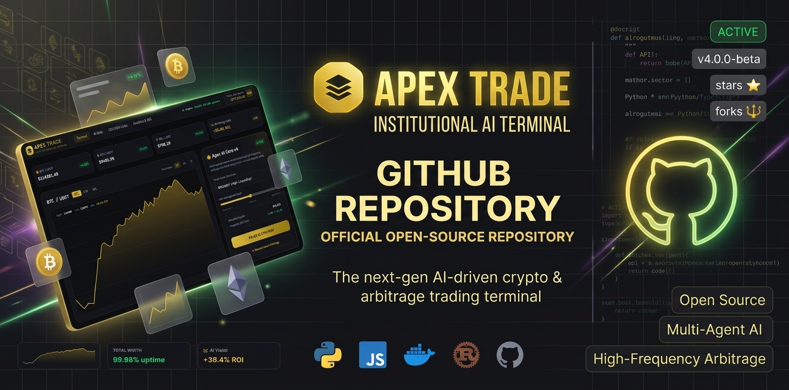
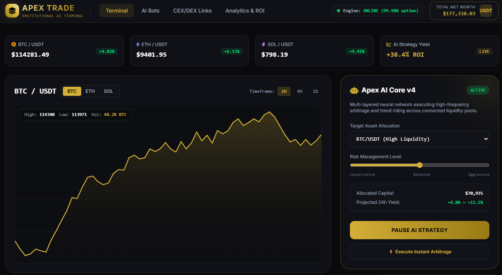

# 🧠 ApexTrade: Local Multi Account API Client

  

  
  
  

  

  

  

> 🧠 **ApexTrade** is a local client for aggregating multiple API endpoints into a single interface. It is designed for developers and analysts who need a unified view of data streams from various services. **Non custodial. No cloud. API keys only.**

## 🧭 OVERVIEW

ApexTrade replaces multiple browser tabs and desktop apps with one local interface. It connects dozens of API endpoints into a single panel, aggregates data streams, and allows for batch actions across accounts.

**This is a local tool.** It does not hold your funds, it does not run in the cloud, and it does not require you to trust a third party with your API keys. You remain in full control.

Built for developers, analysts, and power users who manage multiple accounts across different platforms. Whether you are tracking data from exchanges, blockchains, or custom APIs, ApexTrade gives you one dashboard to rule them all.

## 📊 KEY FEATURES

<table align="center">
  <tr>
    <td align="center" width="25%">
      <h2>🔗 Multi Account</h2>
      <b>API Aggregation</b> 
      Connect 20+ endpoints
    </td>
    <td align="center" width="25%">
      <h2>📊 Data Control</h2>
      <b>Unified Dashboard</b> 
      Aggregated metrics
    </td>
    <td align="center" width="25%">
      <h2>⚡ Fast Processing</h2>
      <b>Sub 50ms</b> 
      Direct routing
    </td>
    <td align="center" width="25%">
      <h2>🔒 Non Custodial</h2>
      <b>API Keys Only</b> 
      Read and Write, no withdrawal
    </td>
  </tr>
</table>

## 🧩 CORE MODULES

<table>
  <tr>
    <td width="50%" valign="top">
      <h3>🖥️ Multi Account Launcher & Dashboard</h3>
      <b>For:</b> Power users running 5 to 20+ accounts simultaneously.  
      Connect every endpoint into one launcher. See aggregated metrics, status, and per-account health in a single view. No more switching between tabs.
    </td>
    <td width="50%" valign="top">
      <h3>⚡ Fast Execution Terminal</h3>
      <b>For:</b> Users who need low-latency order routing.  
      Native DOM panel, direct order routing into matching engines, and hotkeys for one-tap actions. Sub 50ms round trip on a stable connection.
    </td>
  </tr>
  <tr>
    <td width="50%" valign="top">
      <h3>🧠 Local AI Assistant & Backtester</h3>
      <b>For:</b> Developers who write and test strategies.  
      A quantized LLM runs on your own hardware. It writes code, runs backtests on millions of bars, and never sends your data to a cloud. Your ideas stay on your machine.
    </td>
    <td width="50%" valign="top">
      <h3>🌐 On Chain Data Aggregator</h3>
      <b>For:</b> Analysts tracking new pairs on Solana and EVM.  
      Monitor new pairs on Solana (Raydium, Pump.fun, Meteora) and EVM (Uniswap, Base, Arbitrum) inside the same block. Contract checks for honeypot and rug before entry.
    </td>
  </tr>
  <tr>
    <td width="50%" valign="top">
      <h3>🎁 Airdrop Tracker</h3>
      <b>For:</b> Users farming on zkSync, LayerZero, Scroll, Linea, Base.  
      Multi chain activity with human-like randomization that passes Sybil checks. Warm up wallets, spread transactions over time, and track progress in one place.
    </td>
    <td width="50%" valign="top">
      <h3>📊 Unified Risk Dashboard</h3>
      <b>For:</b> Anyone holding positions across several venues.  
      Aggregated drawdown, net exposure, correlation between accounts, and automatic throttle when you approach service limits. Kill switch for the whole book.
    </td>
  </tr>
</table>

## 🎯 WHY APEXTRADE

<table>
  <tr>
    <td width="33%" align="center" valign="top">
      <h3>🔗</h3>
      <b>Multi Account</b>  
      Connect dozens of endpoints into one panel. Manage all your accounts from a single dashboard.
    </td>
    <td width="33%" align="center" valign="top">
      <h3>📊</h3>
      <b>Unified Risk Control</b>  
      Aggregated drawdown, net exposure, cross account correlation, and automatic throttle near service limits.
    </td>
    <td width="33%" align="center" valign="top">
      <h3>⚡</h3>
      <b>Mass Execution</b>  
      One click sends the same order to twenty accounts, sized by each account's own rules.
    </td>
  </tr>
  <tr>
    <td width="33%" align="center" valign="top">
      <h3>🚀</h3>
      <b>Sub 50ms Latency</b>  
      Native DOM panel and direct order routing into matching engines. Optimized for speed.
    </td>
    <td width="33%" align="center" valign="top">
      <h3>🧠</h3>
      <b>Local AI Assistant</b>  
      Quantized LLM on your hardware. Writes strategies, runs backtests, nothing goes to the cloud.
    </td>
    <td width="33%" align="center" valign="top">
      <h3>🔒</h3>
      <b>Non Custodial</b>  
      Read and write API keys only. IP whitelist. Funds always stay on the service or in your wallet.
    </td>
  </tr>
</table>

## 🖼️ DASHBOARD PREVIEW

<table align="center">
  <tr>
    <td align="center" width="50%">
      
        
      <b>Terminal Interface</b> 
      Order routing and execution control
    </td>
    <td align="center" width="50%">
      
        
      <b>AI Bots Panel</b> 
      Automated strategy management
    </td>
  </tr>
  <tr>
    <td align="center" width="50%">
      
        
      <b>CEX & DEX Links</b> 
      Connected endpoints and data sources
    </td>
    <td align="center" width="50%">
      
        
      <b>Analytics & ROI</b> 
      Performance metrics and return tracking
    </td>
  </tr>
</table>

## 🚀 QUICK START

### Step 1 Clone and Install

### Step 2 Configure

1. **Open** the `config.json` file.
2. **Add** your API endpoints and keys.
3. **Run** the application locally.

### Step 3 Launch

1. **Start** the local server.
2. **Open** your browser to `http://localhost:8080`.
3. **Monitor** your aggregated data.

## 📊 KEY FACTS

| Metric | Value |
|--------|-------|
| **Execution Latency** | Sub 50ms |
| **Accounts Supported** | 20+ per client |
| **Chains Supported** | Solana, EVM (Base, Arbitrum, and more) |
| **AI Model** | Local quantized LLM |
| **Custody** | Non custodial, API keys only |
| **Deployment** | Windows, Linux, local VPS |
| **License** | MIT |

## ❓ FAQ

### ❓ What is ApexTrade?
ApexTrade is a local multi account client. It connects API endpoints into one panel so you can see data and execute actions across all of them at the same time.

### ❓ Does ApexTrade hold my funds?
**No.** ApexTrade is strictly non custodial. It uses API keys with read and write permission only. Withdrawals are never enabled. Your funds stay on the service or in your own wallet.

### ❓ Does ApexTrade use the cloud?
**No.** Everything runs on your machine. There is no cloud backend, no remote logging, and no data leaving your system.

### ❓ How fast is execution?
Sub 50ms round trip on a stable connection. ApexTrade uses a native DOM panel and routes orders directly into matching engines.

### ❓ Can I manage multiple accounts at once?
**Yes.** ApexTrade is designed for users running 5 to 20+ accounts. You can send the same action to many accounts at once, with per account rules applied automatically.

### ❓ Does the AI assistant send my data anywhere?
**No.** The AI assistant is a quantized LLM that runs locally on your hardware. It writes strategies and runs backtests without any cloud calls.

### ❓ Does ApexTrade support on chain data?
**Yes.** It supports Solana (Raydium, Pump.fun, Meteora) and EVM (Uniswap, Base, Arbitrum). Same block data aggregation with honeypot and rug checks before entry.

### ❓ Does ApexTrade support airdrop tracking?
**Yes.** The Airdrop Tracker runs multi chain activity with human like randomization designed to pass Sybil checks. It supports chains such as zkSync, LayerZero, Scroll, Linea, and Base.

### ❓ Is the source code open?
**Yes.** The code is open source under the MIT license. You can audit it, run it locally, or deploy it on your own VPS.

### ❓ What platforms are supported?
Windows, Linux, and any VPS. ApexTrade runs locally or on a remote machine you control.

## ⚠️ RISK NOTICE

> **ApexTrade is a local execution and data management tool.** It is provided as is, without any guarantee.
>
> **Using API keys carries a high level of risk** and can result in the loss of data or breach of service terms.
>
> **You are responsible for compliance** with every service agreement.
>
> **Always test in a sandbox environment before deploying real data.**

## 🔗 OFFICIAL WEBSITE

For documentation and the latest release, visit the official website:

[https://apextrade.icu/](https://apextrade.icu/)

© 2026 · **ApexTrade** · Local Multi Account API Client
